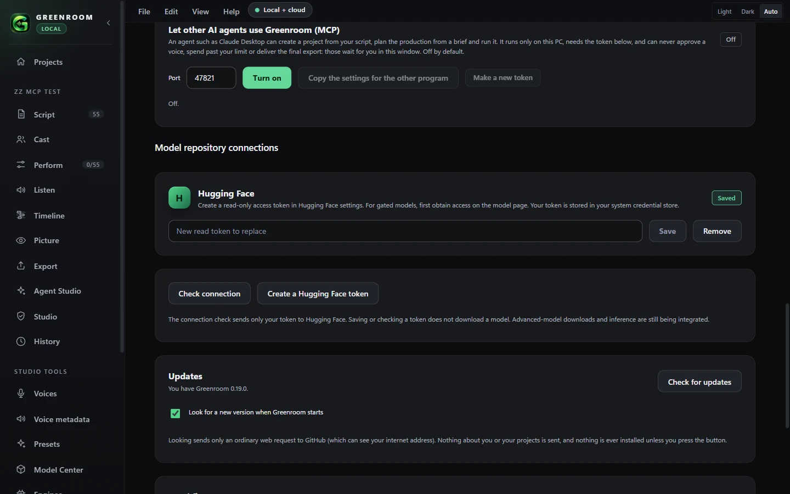

# Agent Studio and the MCP server: giving Greenroom a script or a brief

Two ways to have the app do the work for you:

1. **Agent Studio** (sidebar, with a project open): you describe what you want, the app plans the production, runs it and stops where a person must decide. See [AGENT_STUDIO.md](AGENT_STUDIO.md).
2. **The MCP server** (Settings > Other AI agents, new in 0.19.0): another AI agent, such as Claude Desktop, can create a project from your script, plan the production from a brief and run it, using the same agent and the same rules.



## What "independently" means here (and what it does not)

The agent will do on its own: read the script, plan the steps, make takes with the voices a character has, check the audio, build the timeline, make sound cues, inside the limits you set (local-only by default, a cloud spending limit you choose).

It will **not** do, by design (enforced in code and tested):

- **Approve a voice for a character.** Voice rights and casting approval are the owner's. A voice is only assigned automatically when it is *proven* to fit, and with nothing listened to yet nothing is proven.
- **Spend past your limit,** or spend at all in local-only mode. In Autonomous mode the app shows its own cost sheet and waits for your answer. A paid step is never retried automatically.
- **Deliver the final export.** The last step waits for you.
- **Say how anything sounds.** Only your own listening verdicts (the Listen screen) say that.

**What was found when this was tried for real (2026-11-19):** an outside client created a 55-line, 4-character project from a script, planned 63 steps and ran them local-only. The agent finished "Analyze the script", then stopped at "Recommend the cast" with "The cast needs your decision": the script states nothing about how the characters should sound, no voice is proven to fit, and the casting rules (D-64, `docs/CASTING_INTEGRITY_AUDIT.md`) forbid guessing. So the agent works up to the first casting decision and waits for you. To go further without you, a decision is needed (see "Open decisions" below).

## The MCP server

- **Off by default.** Settings > Other AI agents > **Turn on**. Local to this PC (127.0.0.1 only), on port 47821 unless you change it.
- **Token.** A random 48-character token is made on first use and kept in the Windows Credential Manager. **Copy the settings for the other program** puts a ready MCP config (URL and token) on the clipboard; **Make a new token** invalidates the old one at once. The token is shown nowhere else. Treat the copied config as a password.
- **Protocol.** MCP "Streamable HTTP", JSON replies only: `POST http://127.0.0.1:47821/mcp` with `Authorization: Bearer <token>`. Supported protocol versions: 2025-06-18, 2025-03-26, 2024-11-05.

Example for Claude Desktop or any client that takes an MCP config:

```json
{
  "mcpServers": {
    "greenroom-local": {
      "type": "http",
      "url": "http://127.0.0.1:47821/mcp",
      "headers": { "Authorization": "Bearer <the token from Settings>" }
    }
  }
}
```

(Clients that only speak stdio can use a bridge such as `mcp-remote` pointing at that URL.)

### Tools (the list is `app/src/mcp/tools.json`, shared by the server and the app window)

| Tool | What it does |
|---|---|
| `greenroom_status` | Version, whether a project is open, which cloud key **names** are saved (never values), which local engines are ready, how many voices are in the library. Call first. |
| `list_projects`, `open_project` | See and open existing projects. |
| `create_project` | Create and open a project; pass the script in any format Greenroom reads ([SCRIPT_FORMAT.md](SCRIPT_FORMAT.md)). |
| `set_script` | Replace the open project's script (characters keep voices; unchanged lines keep takes). |
| `get_project` | Scenes, characters with voice and approval state, lines with takes, sound cues, the owner's listening summary, the production state. |
| `plan_production` | The agent plans from a brief in plain words (mode guided or autonomous, local-only, cloud limit). Nothing is made. |
| `run_production` | Runs until a person is needed or everything is done. Paid work shows the app's cost sheet to the person and the call waits. Returns every step's status and what is waiting for the person and why. |
| `get_production_status` | The same status without running anything. |
| `get_listening_todo` | The owner's own verdicts and to-do list. |

There is **no** tool to approve a cast, unlock a voice, spend, clone, export or deliver. A test checks that none can be added with such a name.

### How it is kept safe (all tested: `app/src-tauri/src/mcp.rs`, 11 tests; `app/src/mcp/tools.test.ts`, 11 tests; `scripts/qa/mcp_e2e.mjs`, 25 checks against the real app)

- Binds 127.0.0.1 only. Needs the bearer token (compared in constant time). The `Host` header must be this machine and an `Origin` header, if sent, must be this machine, so a web page cannot reach it, including by DNS rebinding.
- Limits: 16 KB of headers, 1 MB body, 10 s to read a request, no chunked bodies, one tool at a time. Tool arguments are validated against the schema before anything runs (unknown arguments, wrong types, too long, out of range are refused).
- The server only receives and relays. The tools run in the app window with the same code as the screens (`app/src/agent/runner.ts` is shared by Agent Studio and the bridge), so every gate, limit and cost sheet applies.
- If the window is not open, a call says so. If a tool is waiting for you (a cost sheet), the call waits up to 30 minutes for a production run (90 seconds for other tools).

## Open decisions (yours)

1. **Draft casting.** To let the agent carry a script all the way to takes without you, it would have to choose voices for characters. Option: an explicit "Let the agent choose draft voices" switch that picks the best-ranked voices from stated facts, marks each as *chosen by the agent, not approved*, makes takes so you can listen, and leaves approval (rights) to you. This relaxes the "nothing is assigned unless proven" rule only for drafts and only if you switch it on. Not built.
2. **Character sheets.** Scripts and briefs often describe each character ("elderly British baritone", "young Lagos rapper"). Reading such a block would give the casting rules stated facts to work from. Not built (see [IDEAS.md](IDEAS.md)).
3. **Standing authorisation to deliver.** Today delivery always waits for you. A per-run "deliver to this destination within these limits" authorisation is possible if you want fully hands-off runs. Not built.

## Not tested

Claude Desktop itself was not connected (only a plain HTTP MCP client); clients that need stdio need a bridge; the server has not been through an external security review; nobody has listened to audio made through it.
