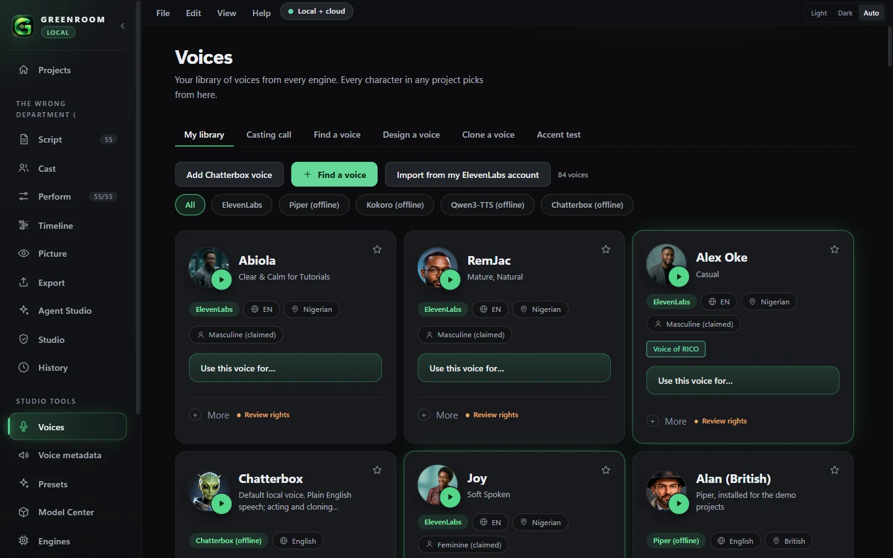
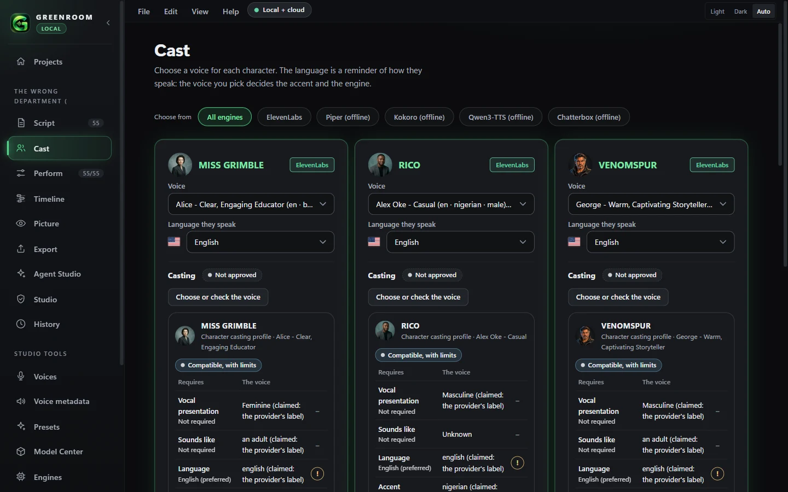
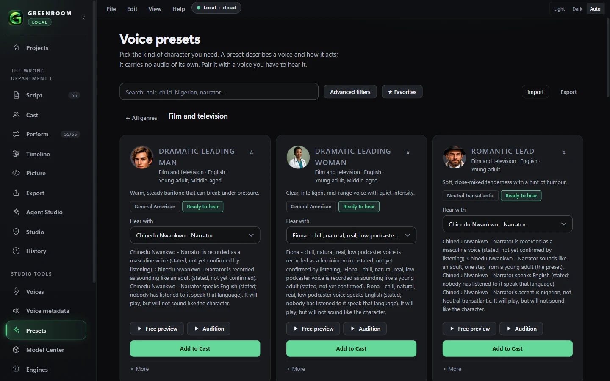
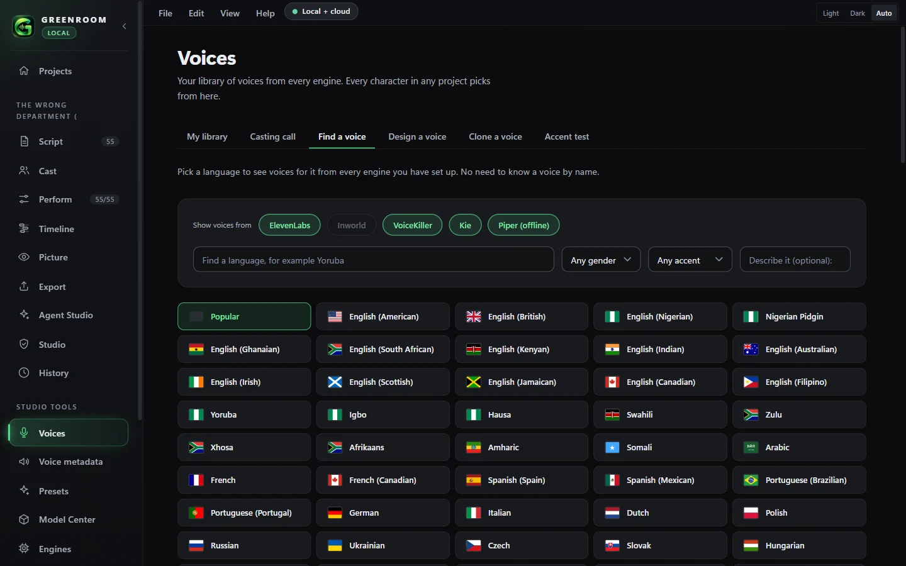

# Avatars: how a face gets onto a voice, a preset or a character

Written 2026-11-12 after the owner kept seeing wrong faces: a man's face on a woman's voice, a European face on a Black Yoruba elder.

## What went wrong

A face was being *chosen for something that never said what it looked like*. The audit of the 120 starter presets found:

- 96 of 120 presets state no gender. Each still got a face, so about half got a face of the wrong gender for whoever later used them (a "dialogue NPC" got a woman, a "safety instructor" an Indian woman, a "psych narrator" an Arab man).
- Presets about a particular people (Hausa-influenced Nigerian English, Filipino English, Indian English) were deliberately kept from reading their culture, so they got whatever face came up: a South Asian man for a Hausa speaker, a Black woman for a Filipino speaker, a white man for an Indian speaker.
- The matcher quietly gave up a stated heritage or age when no portrait fit ("fall back to any face"), so a stated fact could be crossed.
- The portrait browser could not filter by gender or heritage, so choosing by hand meant scrolling 100+ faces.

## The rules now (src/avatarMatch.ts)

1. **A face is chosen only from what is stated** by the owner, a character's own look, a role the preset names outright (an android, a dragon), or an appearance an author wrote on a preset (`PRESET_APPEARANCE`). Never from an accent, a name, a language, how a voice sounds, or an AI guess.
2. **No gender stated: no face.** A neutral mark is shown. A face that guesses the gender is worse than none.
3. **A stated gender, a stated heritage and childhood are never given up.** If nothing fits, there is no face and the card says why ("No portrait in the library is female, child, Middle Eastern. Choose one by hand or add your own").
4. A child or teen gets only child or teen portraits, and nobody else ever does.
5. A preset that states a culture but not how the character looks gets no face, rather than a guess.
6. Ordinary people only by default. Costumes and creatures appear only for a role the preset names, or when the owner browses.

Presets whose appearance an author has written (so they get a face): Yoruba, Igbo, Hausa and Pidgin Nigerian English presets (Black / African), Filipino English (East or Southeast Asian), Indian English (South Asian). That is Greenroom's own statement about those presets, shown in `presets/portraits.ts`; it can be edited, and it is the only place heritage is set for a preset.

## What the owner gets

- **Browse by what a face shows.** The portrait browser has Gender and Heritage filters, built from the library's own look labels (which were judged by eye when the library was built), and each tile says what it shows in its tooltip, e.g. "Female, Black / African".
- **Every voice in a list has a face (0.17.0).** The owner found a library of faceless marks odd. A voice's face is chosen from what the voice itself states (`voiceFace` in `src/avatarLibrary.ts`): its **gender** decides which portraits are possible and is never crossed; its stated age band and, for accents that point to a region (Nigerian, Ghanaian, Kenyan, Indian, Korean, Arabic, Latin American...), its **heritage** narrow the choice when portraits fit. A British, American, Irish or Australian accent chooses no heritage (it says nothing certain about who is speaking). A voice that states **no gender** gets a friendly non-human portrait (a robot, alien or stylised animal) rather than a guessed person. The face is the same every time for the same voice; a picture you chose, or a look you set in the voice card (gender, age, heritage), always wins. A character with no look of its own shows the face of the voice cast for it; a character with no voice yet shows its initials. Presets are unchanged (strict, stated facts only).
- **Auto-chosen faces are always explainable** from stated facts, and never override a face you chose.

## Limits

- The look labels (gender and heritage of each built-in portrait) are by eye from the person who built the library; nobody has re-checked all of them. The tests prove the matcher honours the labels, not that every label is right. If you find a mislabelled portrait, say which and it is a one-line fix in `LOOKS_DATA`.
- The library's heritage categories are coarse (seven). A people not represented by one gets no auto face.
- 96 presets now show a neutral mark instead of a face, on purpose.

## Screenshots (version 0.17.1, real app)

Every voice in the library has a face; Nigerian-accented voices show matching portraits, a voice with no stated gender (Chatterbox) shows an alien, and Piper voices follow their named speaker:

Characters show the face of their cast voice:

Presets show a face only where the preset states a gender, never from an accent or a guess:

Find a voice, before a voice is added:

Audit of the owner's real library (84 voices, 2026-11-19): every voice has a face; 0 faces cross a stated gender; 6 voices state no gender at all (Chatterbox, an ElevenLabs voice labelled neutral, and four Piper voices missing from the name table: Vais, Tsync, Alex and Alma) and show a robot, alien or animal. The tests are `app/src/voiceFace.test.ts` and `avatarMatch.test.ts`.
