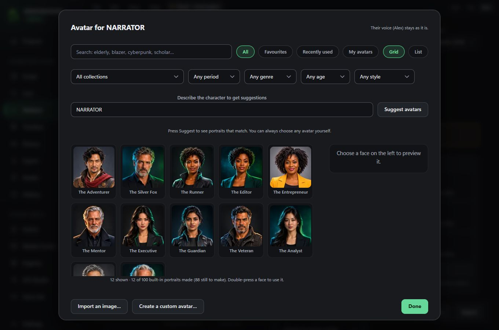
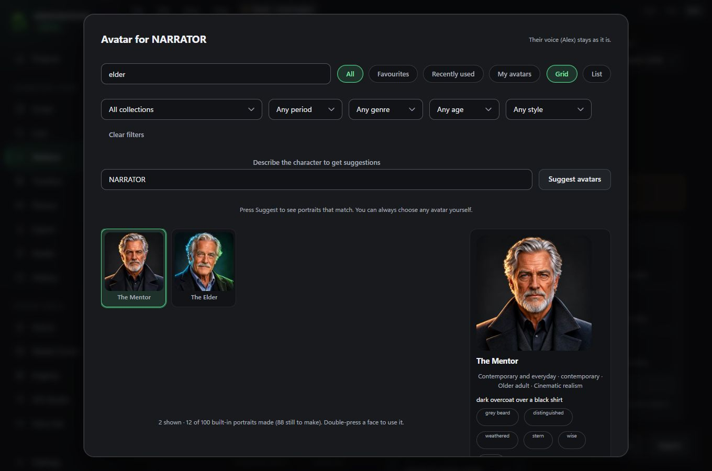
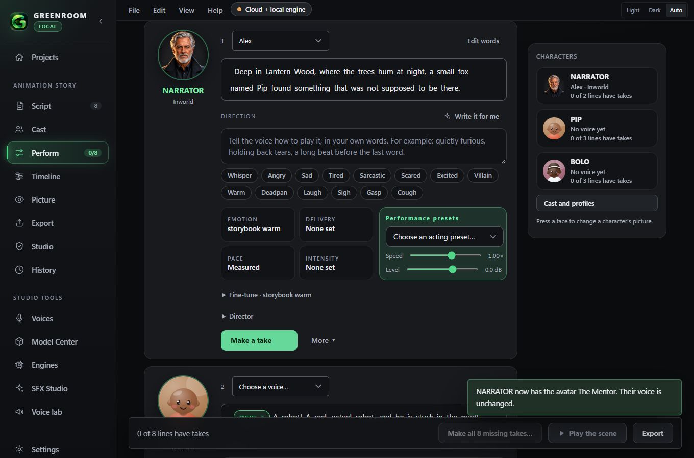

# Character Avatar Library

**Status (2026-11-08): 100 of the 100 required full-resolution portraits exist (10 in each collection), plus 22 preview-resolution portraits that do not count toward the 100.** All 100 passed the file checks: unique ids, exact sizes and formats, no two the same picture, rights recorded. The 88 added in version 0.8.0 were chosen from the owner's three folders (see "How the last 88 were chosen"). **Nothing has been judged by eye for quality beyond one pass over contact sheets, and no portrait has been checked against real people by anyone but that pass.** Nothing was duplicated, recoloured or upscaled to reach the count.

## What the owner gets

Press any character's face (Cast, Perform, the character rail, the Reaction Library) to open the **Avatar browser**.

- **Browse** as a grid or a list; **search** by any word (name, tags, clothing, period, archetype); **filter** by collection, historical period, genre, age category and visual style; only choices that exist are offered.
- **Favourites**, **Recently used** and **My avatars** are one press away.
- **Preview** shows a face large with its collection, period, age, clothing, tags and its **rights status**.
- **Use for [character]** assigns it; **Replace with this** swaps one already assigned; **Remove the avatar** returns to the default face.

- **Suggest avatars** reads a description (it starts from the character's name and profile) and offers matching portraits with the words that matched. It reads appearance words (elderly, blazer, stern, scholar) and **ignores accents and nationalities**: "British" never changes the suggestions. It offers fewer rather than unrelated faces, and you can always choose any avatar yourself.
- **Import an image** makes one of **My avatars** from a picture on your computer; it never leaves your computer.
- **Create a custom avatar** takes a character description, period, genre, visual style, clothing, expression and background, shows the exact text that will be sent, and after a cost sheet (Kie, your own key) makes a picture. Only that text is sent: no pictures, project text or voice data. You name it and choose whether to save it.
- **Expressions**: a custom avatar can hold neutral, smiling, angry, sad, frightened and speaking pictures of the same character. Perform shows the one matching a line's feeling, and the main picture when there is none. A face is never swapped for a different identity.

## Avatar and voice are separate

A character holds separate references: its own id, an **avatar id** (`avatarId`), a **voice** (`voiceId`) and its acting profile (the Voice DNA already on the character). Changing the avatar changes nothing else; changing the voice leaves the avatar alone. The same avatar can serve any number of characters and projects. A portrait never carries a voice, accent or personality: the manifest has no such field and a test fails if one is added. Projects saved before avatars existed open unchanged.

## Two tiers

| Tier | What it has | Counts toward the 100 |
|---|---|---|
| **Master** | 1024 x 1024 PNG master, 512 and 256 WebP cards, 128 thumbnail | Yes (100) |
| **Preview** | Only a 256 WebP card and a 128 thumbnail, cut from a contact sheet. No master and no 512 card, because the sheet tiles are about 330 px and are never upscaled | No (22 so far) |

Previews are labelled "Preview" in the browser and the preview panel says so. The manifest and a test refuse a preview that claims a master or a 512 card.

### What the "NEW IMAGES FOR GREEN ROOM" sheets turned out to be

Five distinct contact sheets (and `IMAGES.png`, an exact copy of `Mosaic-1`). Two sheets hold 15 realistic portraits at about 330 px each; from them 22 portraits were cut after removing one tile with a watermark logo and the near-duplicates of the same subject across the two sheets (the boy in the red hoodie, the alien, the orc, the vampire, the straw-hat elder, the bride, the cowboy: one of each was kept). The three 90-tile sheets (two realistic, one cartoon) have tiles of about 150 x 110 px, smaller than a 128 px thumbnail, so none was used. The cartoon sheet and one mosaic also contain recognisable look-alikes (a Joker, a Wednesday Addams, a Gandalf, an Einstein, a queen who resembles Queen Elizabeth), which must never be used even if they were large enough. Several of the 22 are framed tightly (a hat or hair touches the top edge): the previews were cut, not re-framed.

## Where things live

| Thing | Location |
|---|---|
| Curated entries (metadata, and each portrait's source file name) | `avatars/library.json` |
| 1024 x 1024 PNG masters, kept out of the app bundle | `avatars/masters/` |
| What still has to be made, with a prompt for each | `avatars/plan.json` |
| 512 px WebP cards, 256 px cards, 128 px thumbnails and the runtime manifest, bundled in the app | `app/public/avatars/` |
| The owner's avatars, favourites and recent list | `avatars.json` in Documents/Greenroom Local |

Bundled size for the 100 masters plus 22 previews is about 6 MB; the masters (about 145 MB) are not loaded by the app.

## Adding portraits (the pipeline)

1. Make a portrait from its prompt in `avatars/plan.json` (or your own), square, head and shoulders, face centred with a safe margin, clean background, no text or watermark, at 1024 x 1024 or larger.
2. Add its entry to `avatars/library.json` (id, name, collection, period, genre, style, age category, archetype, clothing, tags, the `source` file name and its `license`), and remove its slot from `plan.json`.
3. Run `python scripts/build_avatars.py --source "<folder with the pictures>"`. It writes the master and the three derivatives, rewrites the manifest, and validates everything. A source under 1024 px is **refused**: masters are never upscaled.
4. `npx vitest run` checks the library on disk (below). Updates are incremental: only new entries are added, and existing ones are rebuilt from their sources.

`python scripts/build_avatars.py --check` validates what is already built: unique ids, every listed file present, exact sizes and formats, no two portraits the same picture (exact hash and a perceptual difference hash), required metadata, rights recorded. It prints how many of the 100 exist and which collections are short.

## The ten collections and what exists

| Collection | Made | Still missing |
|---|---|---|
| Contemporary and everyday | 10 (+7 preview) | 0 |
| Ancient civilizations | 10 | 0 |
| Medieval and Renaissance | 10 (+1 preview) | 0 |
| Victorian and Edwardian | 10 | 0 |
| Western and historical | 10 (+1 preview) | 0 |
| Fantasy and mythology | 10 (+3 preview) | 0 |
| Science fiction and cyberpunk | 10 (+4 preview) | 0 |
| Horror and supernatural | 10 (+1 preview) | 0 |
| Stylized 3D and animation | 10 | 0 |
| Global and cultural archetypes | 10 (+5 preview) | 0 |

Eighty-nine portraits are cinematic realism and eleven are stylized 3D (the whole Stylized 3D collection and one fantasy elf). The cinematic ones are made in a common studio style, so **many faces share a family resemblance** (the same few male and female archetypes recur across the Egyptian, medieval, western and horror sets). The checks only catch identical or near-identical pictures, not "same kind of face", so if the set feels samey in use, that is the cause and those portraits can be swapped.

## Rights

All portraits were **supplied by the owner** (the folders "Green Local avatars" and "NEW IMAGES FOR GREEN ROOM"), who stated on 2026-11-08 that the images belong to them. Each entry records that statement and `commercial_use: "confirmed"` on the owner's word. **The tool that made the images and its terms were not recorded**, so keep your own record of them: ownership of generated images can depend on the generator's terms, and a distributor may ask. None of the portraits used is a recognisable real person or franchise character as far as can be seen, but nobody has verified that, and the orc and vampire are generic fantasy types. The 88 added in 0.8.0 carry the same record. They arrived as 1024 px WebP files and as JPEGs (up to 1254 px) converted by the owner's export from the original PNGs; those originals were not seen, so the masters are one lossy step from the original art.

## QA (what was checked, 2026-11-08)

| Check | Result |
|---|---|
| Every manifest entry references real files; no broken paths | Passed for all 122 (automatic test reads the files) |
| No duplicate ids or asset files; no two portraits the same picture | Passed (exact hashes in the test; perceptual hash in the build script) |
| Masters 1024 x 1024 PNG; cards 512, 256 and thumbnails 128 WebP, exact sizes (previews: 256 and 128 only) | Passed |
| Bundled files small (thumbnails under 15 KB, cards under 120 KB) | Passed |
| Search, filters, favourites, recent, suggestions | Passed (unit tests); suggestions ignore accents and nationalities |
| Assignment: avatar changes nothing else; voice changes nothing about the avatar | Passed (tests, and in the demo the voice stayed "Alex" while the face changed) |
| Persistence of avatar, favourites, recent and custom avatars | Rust test (saves and reloads, refuses bad data) and JavaScript tests; **not tested across a real restart of the installed app** |
| Existing projects open unchanged | Passed (test) |
| No unwanted network requests | Passed (test: the only fetch is the relative manifest; the one paid path asks first). **Not measured with a network monitor** |
| Smooth scrolling and memory with thousands of avatars | **Not measured.** Only visible rows are drawn and pictures load lazily (tested in code); 122 avatars were not enough to stress it, and no thousand-image library exists |
| Shown in Casting Studio, Perform, the character rail, the Reaction Library, the script screen's cast list | Done |
| Shown in Acting Director, Scene Studio, the dialogue timeline, the Voice Library | **Not done.** The Acting Director is the Director panel inside Perform (the face is on its card); Greenroom has no separate Scene Studio or dialogue-timeline faces; the Voice Library still shows voice pictures and drawn faces |
| 100 distinct full-resolution portraits | **Met: 100 exist** (plus 22 previews that do not count). Distinct as pictures; see the note on family resemblance |

## How the last 88 were chosen (version 0.8.0)

The owner supplied three more sources: the folder "Greenroom Avatar Images Vs 2" (79 WebP files, all 1024 x 1024) and the archive `Greenroom_All_Created_Avatars_Optimized.zip` (278 files: individual portraits up to 1254 px, five contact sheets, four "previous batch" folders and an inventory). From these, 225 square files of 1024 px or more were found; 19 were already in the library and 30 were near-duplicates of each other (difference-hash distance of 20 or less), leaving 184 distinct candidates. Each was looked at on numbered contact sheets and 88 were chosen to give each collection exactly ten, favouring different people, ages, cultures and clothing.

Left out on purpose:

- **Look-alikes of known characters:** a face with a Starfleet-style badge, two swamp creatures, a long-bearded wizard in starry blue, a bespectacled boy wizard with a pointed hat, a blue horned monster in a hoodie (two versions), a hoodie-wearing fox that resembles a film character and a black-haired queen with a high collar.
- **Text on the picture:** a fire-fighter helmet reading "FIRE RESCUE" and a banner reading "SPQR".
- **Not head-and-shoulders:** six full-body figures.
- **The 100 "previous batch" images at 512 px:** too small for a master (masters are never upscaled), and already counted in the tiers above if used at all.
- **One unsettling wet-haired child**, as too close to a well-known horror image.

Many near-identical variations of the same face (for example eight similar Egyptian elders) were reduced to one or two.

## Automatic faces (version 0.8.3)

A voice or character with no chosen avatar shows a built-in portrait, not a cartoon. The pick is steady for a voice and never saved. Rules (all in `app/src/avatarLibrary.ts`, covered by tests):

- Only **everyday** portraits are used (the contemporary masters, five global ones and the 38 "everyday" previews added from the owner's 512 px earlier batches). Costume portraits (pharaoh, knight, vampire, robot and so on) are never chosen automatically; they remain in the browser.
- Gender is never crossed. It is read from the voice's gender field, then its description, and for the local Piper voices from a name table (from the model cards as remembered, **not verified by ear**).
- Age: a child's portrait only for a voice that says it is a child. Heritage: used when the voice states it (Black and East Asian are strict, others allow close groups). When nothing fits, age loosens first, then heritage within the allowed groups, never gender.
- What each portrait shows (gender, heritage) was judged by eye by the person who built the library and lives in `LOOKS`, apart from the manifest; a portrait still carries no voice, accent or personality.
- The 38 added previews are 512 px images cut to 256 px. They count in the browser as previews, not toward the 100.

### Version 0.8.4: 34 more everyday portraits

The owner supplied 51 more 1024 px images (folder "Greenroom Avatar Images Vs 2 - 22101221"). 34 everyday portraits were added as full-resolution masters (15 Black men and 7 Black women of different ages, 9 children, 3 other adults), giving 134 full-resolution portraits (the 100 target is met and passed). Left out: the horned demon, devil and mad-scientist fantasy characters, a black-and-white fedora portrait, a rider on a horse, a chief in full regalia, and a Scottish warrior. They remain on the owner's disk and can be added. The pharaoh/priest-type costume portraits are still never chosen automatically (see Automatic faces).

### Version 0.8.5: 10 women, preview tier

The owner supplied 12 images of women in a folder "Women" at 1376 x 768 (not square). The largest square is 768 px, which is below the 1024 px a master needs and is never enlarged, so 10 were added as **preview-tier** portraits (a 768 px square cut from the middle, reduced to 256 px). Left out: a horned demon and a Victorian velvet-collar lady (not everyday). Five of the ten are Black women. If you can supply the same portraits at 1024 x 1024 or larger (or a wider-framed 1:1 version), they can become full masters.

## Version 0.8.6: faithful automatic faces (review and tests)

What was wrong, found by the owner and by review:
- **Two faces in one circle:** 36 of the 38 "everyday" previews cut from the owner's 512 px earlier batches carried a strip of a different portrait along the top (and a few along the bottom), because the source images are tiled. The strips are now cut off before the 256 px card is made, and all 37 previews were checked by eye.
- **A look-alike of a film character** (a man with swept hair in a red and black costume) was removed.
- **Race, age and gender were not always respected.** Now: the gender field of a voice wins over words in its description; a stated heritage (from the accent, language, country or description, for example Nigerian, Swahili, Hindi, Korean, Jordanian, Mexican, Castilian, British, American) is matched exactly, and only dropped if no portrait of that gender and age exists; a child's portrait goes only to a child and an adult's only to an adult; a voice that says nothing gets an adult. American, British and other Western voices with no other cue get white portraits; the owner can always choose another avatar.
- **Creatures and story roles:** a voice or character described as a dragon, robot, alien, vampire, ghost, goblin, devil, monster, elf, dwarf, pirate, pharaoh, cowboy, knight and so on gets a matching portrait (of the right gender where it has one). Merely containing a word (for example "bearing") does not trigger it.
- 26 more portraits from the owner's "Others" folder (which is the same set as the zip): horned demons, a goblin, elves, robots, aliens, a dragon, spirits, an alchemist, a pirate and others. Left out: those resembling franchise characters (blue horned monsters, swamp creatures, a boy wizard with round glasses, an evil queen, a firefighter with text on her helmet).

Known gaps, listed by a test so they cannot be hidden: no everyday portrait yet of a South Asian, Middle Eastern or Latino male child or elder; a South Asian, Middle Eastern or Latina female elder; a Middle Eastern girl. A voice in one of these groups gets the nearest fit (same gender and age group, other heritage) until portraits are added. "m/f" for the portraits' gender and their heritage were judged by eye by the person who built the library and may be wrong in places.

## Version 0.8.7: voices carry gender, age and heritage

The owner asked that voices have age, gender and so on, so pictures are allocated from that and not guessed. Now:

- Each voice has **Gender**, **Age** and **Heritage** fields. Press **More** on a voice card (or press the voice's face) and set "Who is this voice?". They are used only to choose the automatic picture, and they outrank anything guessed from the description. Changing them changes the picture at once; nothing else about the voice changes.
- **ElevenLabs age labels** (young, middle_aged, old) are read from the account and the shared library and stored as the voice's age. The local (Piper) voices are given a gender when added, from a name table (from the voice model cards as remembered, not verified by ear).
- A voice that states **no age** gets a young-adult, adult or middle-aged face, never an elderly one or a child. Before, an unstated voice could get anyone (a "Happy Chloe" voice got an old woman).
- 12 more portraits from the owner's "mideastern" folder fill the remaining gaps: Middle Eastern and South Asian boys and a Middle Eastern girl, elders of both genders in several heritages, and two adult men. Every combination of gender (2) x heritage (6) x age (child, adult, elderly) now has an everyday portrait, and a test checks all 36 combinations.
- No Southeast Asian portraits were in that folder: the East Asian group has the existing ones (Chinese, Japanese, Korean, Filipino-looking); more would help.
