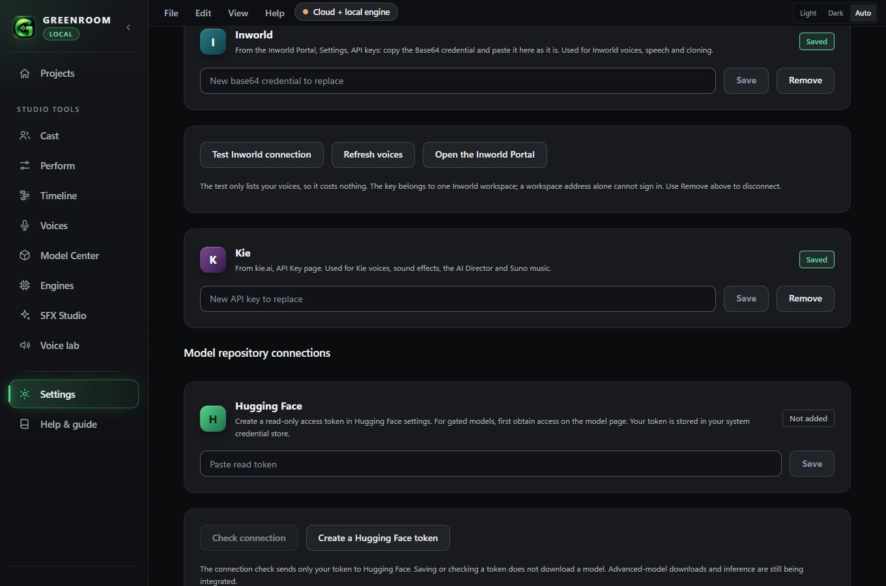
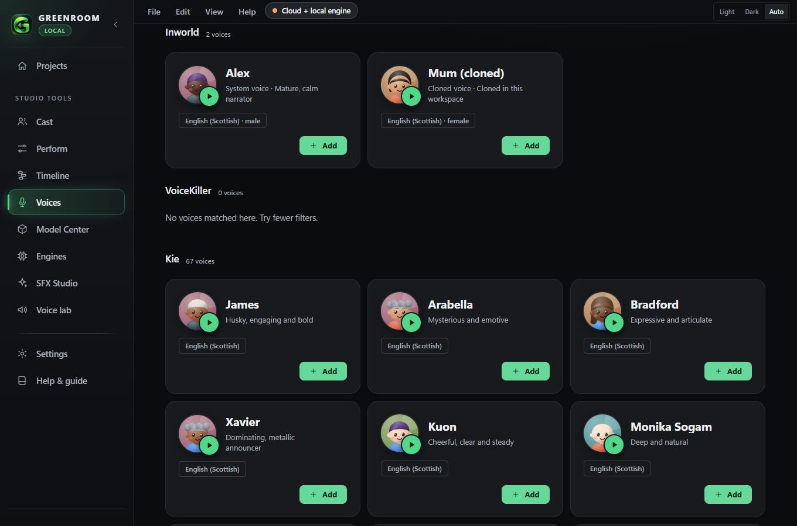
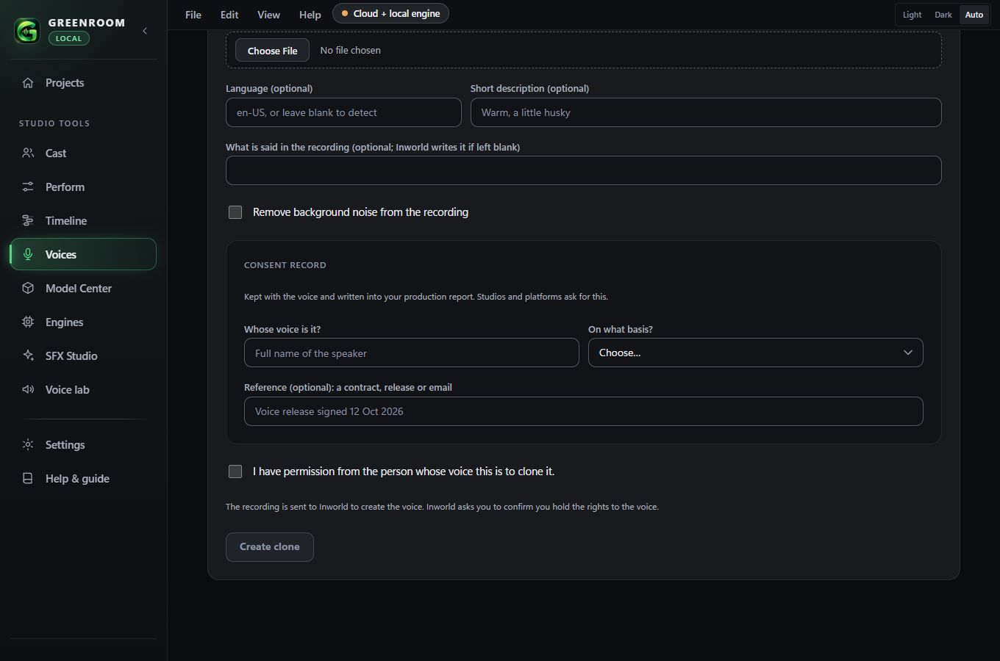
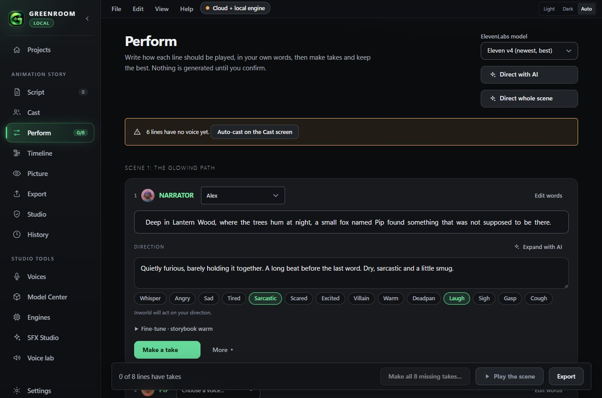
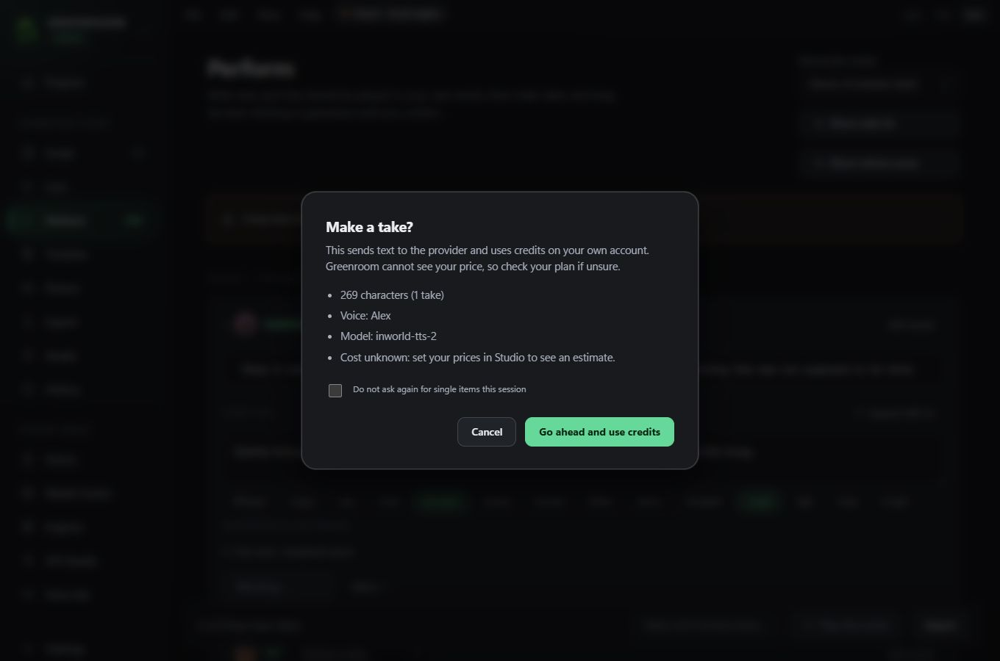

# Inworld voices

Inworld is a cloud voice engine alongside ElevenLabs, VoiceKiller and Kie. Greenroom's adapter is `app/src-tauri/src/inworld.rs`, written from the Inworld documentation read on 2026-11-08 (https://docs.inworld.ai/). **It has been tested against a fake local server only. No live Inworld call has been made**, so how it sounds, what it costs and whether the account's plan allows each feature are unconfirmed.

## Connect

Settings, **Inworld**. In the Inworld Portal copy the **Base64 credential** for an API key and paste it as it is. Greenroom stores it in the Windows Credential Manager like every other key, never shows it again and never writes it to a project, log or export. It sends it only as `Authorization: Basic <credential>`.

- **Test Inworld connection** lists your voices (one request, no speech, no charge) and reports how many the key can see.
- **Refresh voices** reloads the voice list.
- **Remove** disconnects. A workspace web address alone cannot sign in: the key belongs to one workspace.

## Find and add voices

Voices, **Find a voice**, choose a language. Inworld voices appear with the others, labelled **System voice**, **Cloned voice**, **Designed voice** or **Workspace voice** from the source Inworld reports (`SYSTEM`, `IVC`/`PVC`, `TVD`, other). The exact Inworld voice id is kept. Greenroom fetches up to 4,000 voices (20 pages of 200) and says when the list was cut.

Inworld's listing has no preview URL, so **hearing a voice makes a short line through the streaming endpoint (MP3)**. That is billed, so Greenroom asks first.

Voices you add can be cast on **Cast** and are saved with the library, so a recurring character keeps the same Inworld voice id across projects.

## Clone a voice

Voices, **Clone a voice**, choose **Inworld**. You need a WAV or MP3 recording up to 12 MB (Inworld says about 10 to 30 seconds is enough and uses the first 30). You must give the speaker's name, the basis for using the voice and tick the permission box; the app checks the permission again in the backend and refuses without it. The consent record is saved with the voice and appears in the production report. Optional: language, description, a transcript and background-noise removal. A confirmation sheet appears first because **Greenroom does not know what Inworld charges for cloning**.

## Direct a performance

Models: **Inworld TTS 2** (`inworld-tts-2`) and **Inworld TTS 2 Flash** (`inworld-tts-2-flash`), chosen in Engines. Greenroom sends only what Inworld documents:

| Your direction | TTS 2 | TTS 2 Flash |
|---|---|---|
| Written direction and emotion chip | Sent as one English instruction in square brackets, such as `[say sarcastically. Dry and polite.]` | **Not sent.** Flash ignores instructions. Perform says so. |
| Laugh, sigh, cough, clear throat | Sent as `[laugh]` `[sigh]` `[cough]` `[clear throat]` | Same |
| Out of breath, panting, heavy breathing | Sent as a plain `[breathe]` (an approximation, and the sheet says so) | Same |
| Gasp, crying, grunt, strain and other sounds | **Not sent.** Inworld documents no such sound. Use a sound clip. | Same |
| Speed | `speakingRate` 0.5 to 1.5 | Same |

Whatever cannot be sent is listed in the cost sheet before you pay ("Not sent: ...") and is recorded on the take (`notSent`). The wording of the emotion phrases (for example "say wearily") is Greenroom's own and has **not been judged by ear**. Do not treat it as proven until you listen.

Delivery mode (`STABLE`, `BALANCED`, `CREATIVE`), Inworld's own reasoning mode, lip-sync data, word timestamps, multi-speaker scripts and pronunciation dictionaries exist in the API. The adapter supports delivery mode only inside the Rust client; none of them is exposed in the app yet.

## Cost

Every Inworld action goes through the confirmation sheet: model, character, character count (including the bracketed tags, which Inworld counts) and an estimate when you have entered a price in Studio. **Inworld's per-character prices are not in its API documentation and are not built in.** Enter your own price per 1,000 characters for Inworld in Studio. Inworld bills in UTF-16 code units and states that batch synthesis is 20% cheaper; Greenroom does not use batch synthesis.

A failed or rate-limited request is retried only for HTTP 429 (twice, honouring `Retry-After` up to 10 s), because a rejected request was not generated. Any other error is reported once and not retried, since a retry could be billed twice.

## Audio

Takes are requested as 48 kHz WAV through `POST /tts/v1/voice` (text up to 2,000 UTF-16 units). The adapter refuses a reply that is not a RIFF file. Previews use `POST /tts/v1/voice:stream` (up to 4,000 units, newline-delimited JSON, MP3), joined in order; an error line after a 200 status is reported. Takes are saved as immutable files like any other, with the voice id, model id, what was sent and the characters charged recorded in the take's provenance. A source that is already lossy is never presented as more than it is.

## Performance manifest

Export, **For other software**, **A performance manifest (.json)** writes `<project> - performance manifest.json` (schema `greenroom.cinematic-performance`, version 1) with each line's text, direction, voice (engine, id, consent), chosen take (model, steering sent, tags sent, what was not sent, SHA-256) and cue. Word and phoneme timing are `null`: Greenroom does not measure them. Inworld can return word timestamps; asking for them is not built.

## What was tested

- **Rust (fake local server, no network, no cost):** the Basic header and that a rejected key is never echoed; connection check; voice listing with pagination, de-duplication and rejection of unsafe ids and filters; speech request fields (voice, model, 48 kHz WAV, speaking rate, delivery mode, language); no delivery mode on Flash; refusal of bad input before any request; the clone consent rule; non-WAV and empty replies; streamed lines joined in order and in-stream errors; 429 retry then success and a hard limit; no retry on a 500; cloning request fields, recording checks and no upload of a rejected recording.
- **TypeScript:** steering on TTS 2, none on Flash, documented tags only, line text never changed, pronunciation applied, catalogue labels and exact ids; the manifest.
- **Not tested:** any real Inworld request; the clone permission refusal through the app window (the rule itself, `consent_ok`, has a unit test); project reopening with an Inworld voice in the installed app; export of an Inworld take through the timeline (the take is an ordinary 48 kHz WAV, but this was not run); credential storage in the real Windows Credential Manager.
- Security: `rafter secrets .` found nothing. `rafter run` could not run (no scan quota left). A manual review checked the key path (allow-listed name, never returned or logged), request construction (voice id, model, language and filter values validated, never concatenated), response size caps and consent enforcement.

## Known limits

- Inworld pricing is unknown to the app; costs show as unknown until you enter a price.
- The emotion phrases are unverified by ear.
- Instant cloning is billed by Inworld in a way Greenroom cannot see.
- Inworld voice design, workspace voice editing (`PATCH`) and deleting a voice are not built.
- Streaming is used for previews only, not for finished takes.
- No automatic routing between Inworld and other engines, and no A/B comparison of the same line yet.
