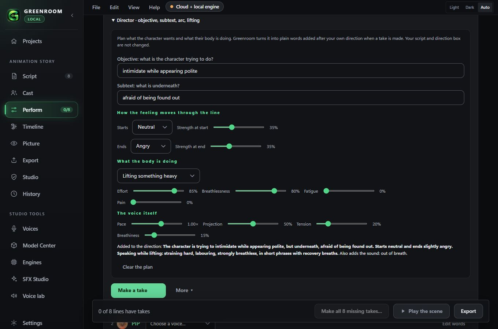
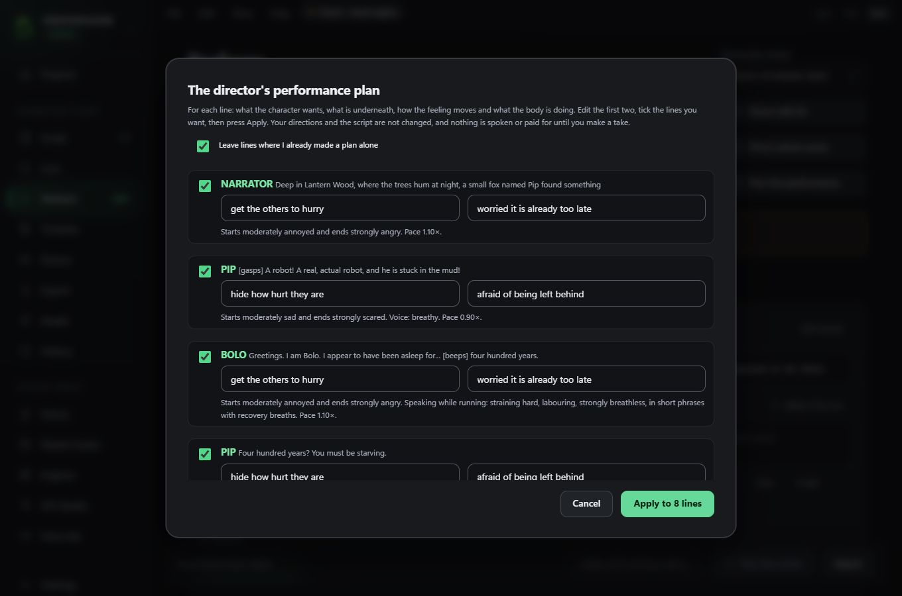
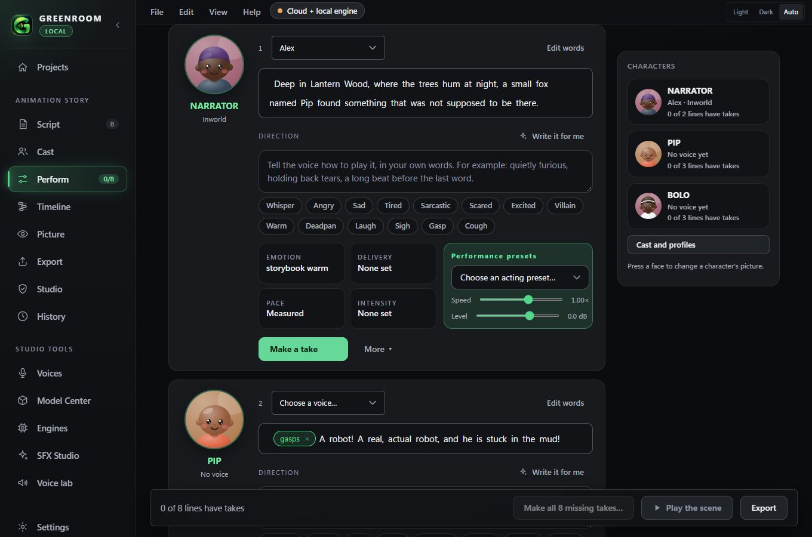
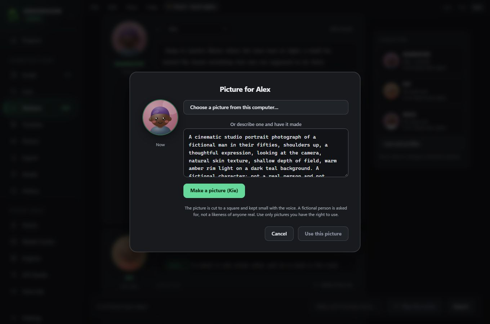
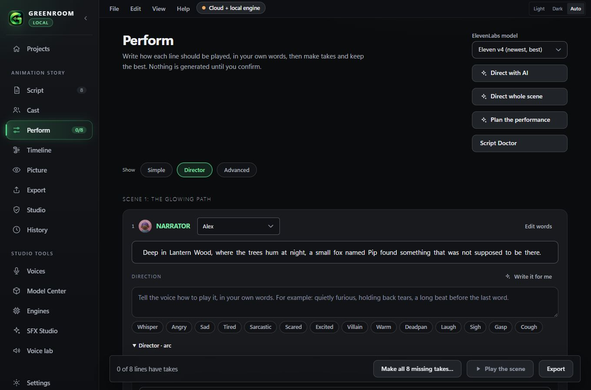
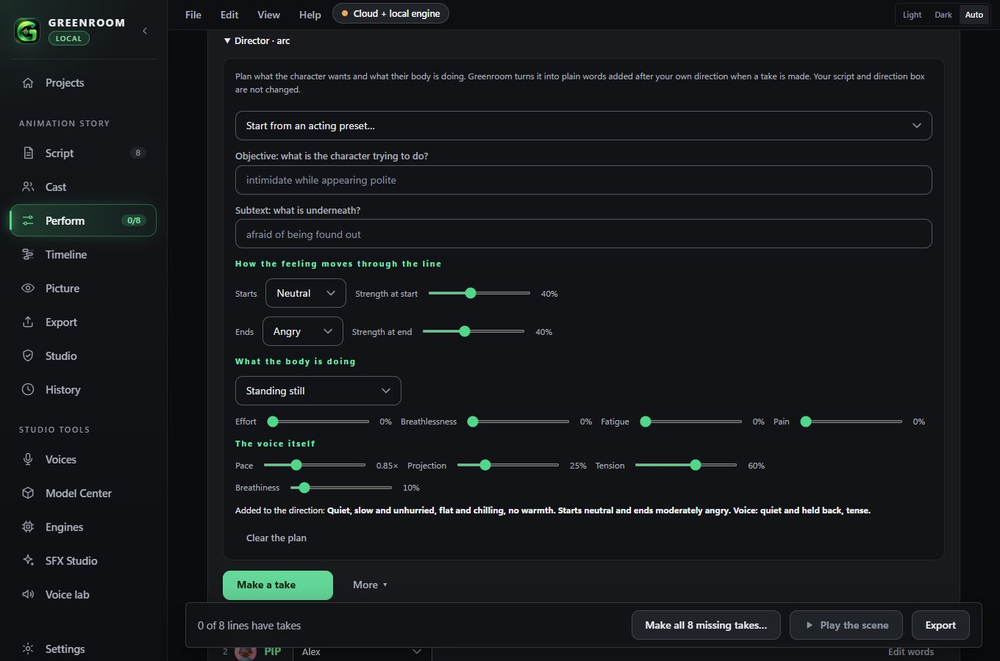
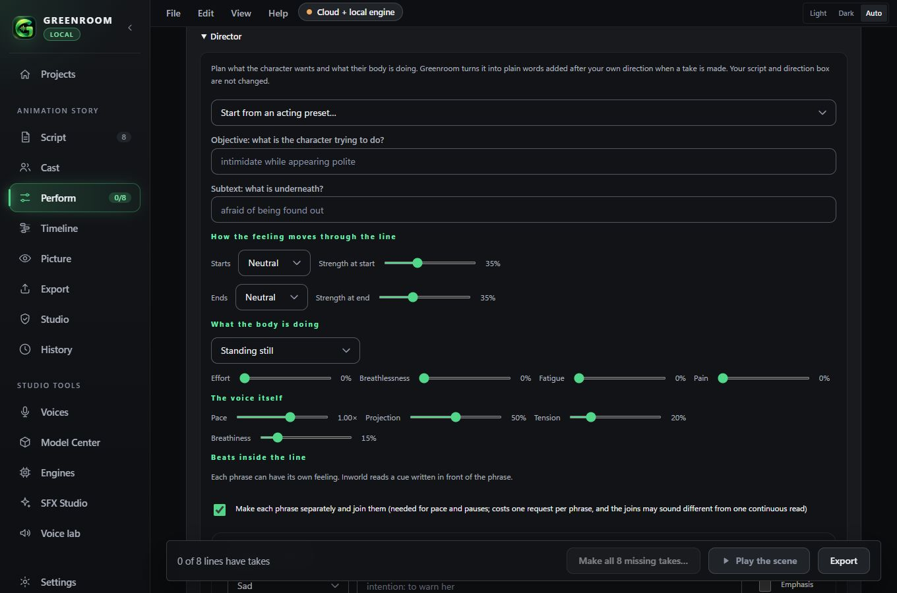
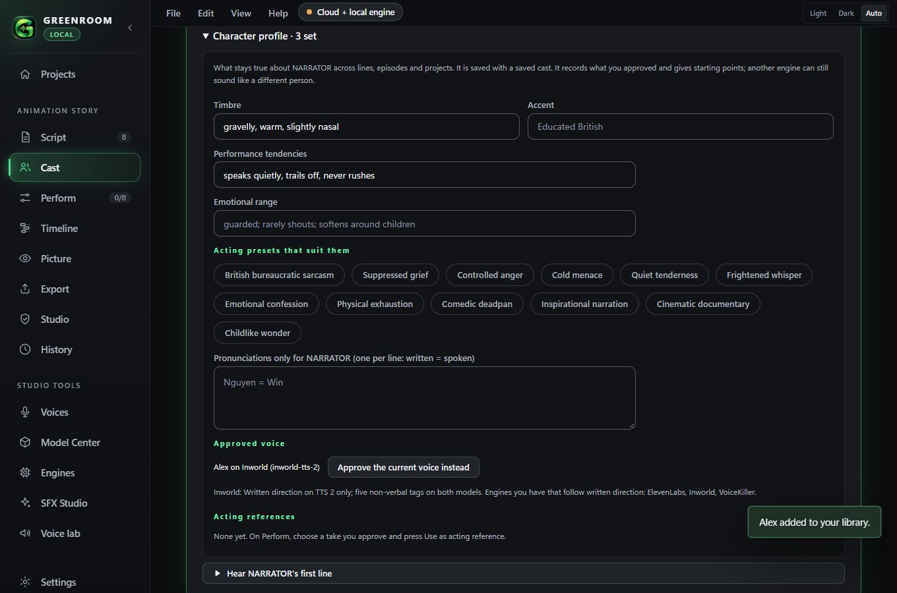
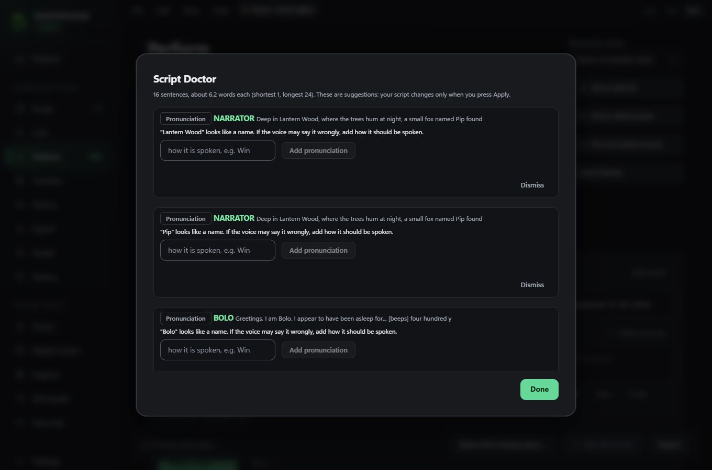

# Greenroom Local User Guide

Write a scene, give each character a voice, direct how every line is played in your own words, make takes, and export the finished audio. This guide follows the shortest path from an empty app to a finished mix.

Screenshots show the demo build, so some voice names and prices will differ on your computer.

## 1. Start a project

Open **Projects**. Type a name and press **New project**, or start from a template (Animation story, Audio horror, Sci-fi and more).

Your work saves automatically. To come back to it later, choose **File > Open project…** (Ctrl+O) and pick it from the list.

## 2. Write the script

Open **Script**. Write one line per speaker as `NAME: what they say`. Put a direction in brackets after the name, and start a new scene with `# Scene title`. Press **Insert a sample scene** to see the format.

Greenroom lists the characters it found on the right. Press **Done, choose voices** when you are ready.

## 3. Cast the voices

Open **Cast**. Give every character a voice from your library. **Auto-cast** can suggest a different voice for each character. Anything that downloads shows a confirmation first, and it says plainly that nothing from your project is sent.

A voice belongs to one engine (ElevenLabs, VoiceKiller, Kie, Piper and so on), so choosing a voice also chooses the engine. Cloned, designed and library voices all work the same way here.

## 4. Direct each line, in your own words

Open **Perform**. Every line is one card: the speaker and voice, the words, a **Direction** box, quick styles, and one **Make a take** button.

**Write the direction yourself.** Type how the line should be played, in plain English, up to 400 characters. For example: *Quietly furious, barely holding it together. A long beat before the last word.* You are not limited to a list of tags.

**Or click a style.** Whisper, Angry, Sad, Tired, Sarcastic, Scared, Excited, Villain, Warm and Deadpan each add a full sentence to the box. Click the style again to take it out. Whatever else you wrote stays.

**Or let the AI write it.** Press **Write it for me** (empty box) or **Expand with AI** (a few words typed). It asks for confirmation first because it uses a text model, then puts the result in the box for you to edit. Nothing is spoken until you make a take.

**Or direct the whole scene at once.** Press **Direct whole scene** at the top of Perform. The AI reads your script, including the action and stage directions, and writes a full direction for every line, following each character's feeling through the scene (when it builds, breaks, softens or is hidden). A confirmation shows the size first. Then you get a review list.

Edit any direction in the list, tick the lines you want, and press **Apply**. Lines where you already wrote a direction are unticked by default. Nothing is spoken or paid for until you make a take. **Direct with AI** (the other button) still suggests short styles, sounds, speed and pauses instead.

**Reuse a good phrase.** The **Recent…** menu remembers your last eight directions.

Greenroom tells you under the box what your voice can do with the direction:

| Voice | What happens to your written direction |
|---|---|
| ElevenLabs (library, designed or cloned) | Acted on. Each sentence is sent as an acting cue before the line. |
| VoiceKiller | Acted on. Sent as a written instruction. |
| Inworld | Acted on with **Inworld TTS 2** (an English instruction in brackets) and laughs, sighs, coughs and breaths as tags. **TTS 2 Flash** does not follow written direction. Anything it cannot do is listed before you pay. See [Inworld](INWORLD.md). |
| Kie, Piper, Chatterbox, Wazobia, your own local server | These engines cannot act on written words. Greenroom says so. Use **Re-voice a recording** to perform the line yourself, or pick an ElevenLabs or VoiceKiller voice. |

**Press Ctrl+Enter** inside the Direction box to make a take without reaching for the mouse.

### Plan the performance (Director panel)

Under **Fine-tune** each line with a voice has a **Director** panel for planning rather than tagging.

- **Objective and subtext:** what the character is trying to do, and what is underneath.
- **How the feeling moves:** a feeling and strength at the start of the line and at the end.
- **What the body is doing:** standing, walking, running, lifting, pushing, fighting, hurt, cold or your own description, with effort, breathlessness, fatigue and pain.
- **The voice itself:** pace, projection, tension and breathiness.

Greenroom turns the plan into at most four short plain-English sentences and adds them **after your own direction** when a take is made, and the panel shows exactly what will be added. Very high breathlessness also adds the verified out-of-breath sound. Pace multiplies the line's speed. Your script text, the chips and the Direction box are never changed, and **Clear the plan** removes it. A voice that cannot act on written words (Piper, Chatterbox, Kie and others) can only follow the pace, and the panel says so. Plans are saved with the project; older projects simply have none. They are included in the performance manifest.

**Let the AI plan the whole scene.** Press **Plan the performance** at the top of Perform. The Director (the local Qwen3 model, or Kie in the cloud) reads the script, including action lines, and for every line proposes an objective, a subtext, how the feeling moves from start to end, what the body is doing and the voice qualities, thinking about motivation, who the character is speaking to, hidden feelings and how the scene builds. A confirmation shows the size first when it uses Kie; the local Director costs nothing. You then get a review list.

Edit the objective and subtext, tick the lines you want and press **Apply**. Lines that already have a plan are unticked by default. Only each line's plan is written: your script, chips and Direction box are untouched, and nothing is spoken until you make a take. Long scripts go in batches of 20 lines, each sent with the whole script for context.

This is wording sent to a model that may or may not obey it. Whether the result sounds strained or breathless is for you to judge by ear.

### The Perform screen

Each line is a card led by its character's **portrait**. Along the top are the tabs **Quick Perform**, **Director**, **Advanced** and **Reaction Library**, then one row of AI tools (Direct with AI, Direct whole scene, Plan the performance, Script Doctor). On each card, four tiles (**Emotion**, **Delivery**, **Pace**, **Intensity**) show what is set and open the Director panel when pressed; the **Performance presets** box holds an acting preset, speed and level. On the right, **Characters** shows who speaks, with which voice, and how many of their lines have takes; press a name to jump to their first line.

### Pictures for voices

Every voice has a drawn clay face. To give a voice a real picture, press its face (on Perform, Cast or Voices) and either **choose a picture** from your computer or **describe one and have it made**. The description is written for you from what the library knows (gender, and words like warm, stern or elderly in the voice's notes); it asks for a **fictional person, not a real one**, never guesses heritage from an accent or name, and you can edit it. **Make a picture** sends only that text to Kie's image model (the model page says about 8 Kie credits, about USD 0.04, per picture; Greenroom cannot see your price) after a cost sheet. The picture is cut to a square, kept small with the voice in your library, and shows on every screen that voice appears. **Go back to the drawn face** removes it. Use only pictures you have the right to use.

Making pictures uses the model id and settings from Kie's Nano Banana 2 model page (read 2026-11-08), not a reference page, and has only been run against a fake server: if Kie has changed them, the cost sheet appears and the request fails with Kie's message.

### Show: Simple, Director or Advanced

At the top of Perform, **Show** chooses how much each line card displays. **Simple** is the voice, the Direction box, quick styles, **Make a take** and playing. **Director** (the default) adds the Director panel. **Advanced** adds Fine-tune: speed, level, pause, every emotion and sound, and the exact text sent. Your choice is remembered on this computer.

### Acting presets and four interpretations

- **Start from an acting preset** in the Director panel sets the feeling, body, pace, projection, tension and breathiness for British bureaucratic sarcasm, suppressed grief, controlled anger, cold menace, quiet tenderness, frightened whisper, emotional confession, physical exhaustion, comedic deadpan, inspirational narration, cinematic documentary or childlike wonder. A preset keeps your objective and subtext. Presets that suit a character are starred (see Character profile).
- **More, Make 4 interpretations** makes the same line four ways: **Natural** (exactly as planned), **Restrained** (feeling turned down, understated), **Expressive** (a wider range) and **Intense** (pushed close to the limit of control). It shows one cost sheet for all four, keeps the take you already chose, and labels each take with its interpretation.

The preset and interpretation wording has not been judged by ear. A voice that cannot act on written words can only follow the pace, and Greenroom says so.

### Beats inside a line

A line is split at its commas and full stops into **phrases**, and each phrase can have its own feeling, intention, emphasis, pace and pause after it. Your script text is never changed: the phrase texts are only used to find the beats again, and a beat is dropped if you edit its phrase away.

There are two ways a beat reaches a voice:

- **One request with written cues** (default): the feeling is written in front of the phrase as a cue, and emphasis capitalises the key word for **Inworld** voices (Inworld documents capitals as emphasis). Pace and pause **cannot** be sent this way; the cost sheet lists them as not sent.
- **Make each phrase separately and join them**: every phrase is its own request with its own feeling and pace, and your pauses are real silence between them. It works with any voice, but it costs one request per phrase (the cost sheet shows the number), and the joins can sound different from one continuous read, so listen to them. The take's Details say it was made phrase by phrase.

**Remake one phrase.** On a take made phrase by phrase, open **Details**: each phrase is listed with its timing and a **Remake this phrase** button. It makes one request (confirmed first), joins the new phrase back between the untouched rest with your pauses, and adds the result as a **new take**; the old take is kept.

### Sound ideas from your stage directions

**Script Doctor** also lists sound ideas read from the lines of your script that are not spoken (for example "(The door slams.)" on its own line after a blank line): a door, footsteps, rain, a phone, glass and similar. Each shows the sound it would make, the stage direction it came from and the line it would sit beside. **Make this sound** is an ordinary sound clip: it confirms the cost first and is kept as a take on that line. A row straight under a spoken line is read as part of that line, as the script parser does.

### Position and distance

In **Advanced**, Fine-tune has **Position** (left to right) and **Distance** (close to far). Distance makes the voice up to 12 dB quieter and closes a low-pass from 20 kHz to 2.5 kHz, as air softens far sounds. They apply to the mix and the stems (and to that line's sound clips), not to the untouched line files. Atmosphere and music are not moved. This is a simple perspective, not a room simulation.

### Reactions for a character

On a line's sound clip, **Save to reactions** keeps it with the character. On any other line of that character, the sound box offers **Reuse a saved reaction (free)**: it uses the same clip file, makes no request and spends nothing, and the clip's provenance and rights go with it.

### Character profile and acting references

On **Cast**, each character has a **Character profile** (their Voice DNA): timbre, accent, performance tendencies, emotional range, the acting presets that suit them, pronunciations only they use, the voice you approved for them, and acting references. It travels with a **saved cast**, so a series keeps its characters from one project to the next. If you later change the character's voice, engine or Inworld model, Greenroom warns that their identity may change.

On Perform, choose a take you approve and press **Use as acting reference**. Greenroom measures that take (words a second, pauses, level, the rough pitch and how it moves) and keeps the measurements with the character. On another line, **Match acting reference** in the Director panel sets pace, projection and the pause after from it. These are estimates to listen to and change; another voice or engine will not copy the delivery exactly.

### Compare takes

When a line has two or more takes, **Compare takes** opens them side by side. Each has a player and a waveform on one shared time scale (a longer take looks longer), and a table compares length, speaking time, pace, pauses, silence at each end, level, liveliness and rough pitch. These are measurements; which take is better is for your ears. It is the natural place to listen to the four interpretations.

### Script Doctor

**Script Doctor** on Perform suggests breath (a long stretch with no pause, with a comma before a conjunction), pronunciation (names, abbreviations and accented words that may need a spoken form, which you supply), emphasis (the word a "not X but Y" sentence turns on, offered for Inworld voices only) and rhythm (a very long line, or sentences that are all the same length). **Nothing changes until you press Apply** on one suggestion, and the original wording is shown beside any rewrite. It has no pronunciation dictionary, so it cannot say how a name sounds: it asks you. It does not offer IPA because none of Greenroom's voice engines documents it.

### When a direction is longer than the line

A long direction in front of a few words can make a voice read the direction aloud or repeat the line (this happened on a three-word line with a 280-character direction). Greenroom now sends only as much direction as the line can carry: the first sentence is shortened if it must be, and later sentences are kept whole or left out. Perform tells you when a short line gets only part of your direction, and **Advanced** shows exactly what is sent. A new take that comes back far too slow for its words, or in several phrases, gets a **check by ear** badge.

### Sound clip checks and the technical QA report

New sound clips are checked automatically (clipping, silence, very low level, an off-centre waveform, length against what you asked, low sample rate) and show a warning badge when something is worth a look. **Export, For producers and legal, Technical QA report** writes a table of the same measurements for every file in the mix. These are measurements, not a judgement of how anything sounds.

### Fine-tune and More

- **Fine-tune** holds the extras: situation presets (lifting something heavy, running, crying while talking), every emotion and sound chip, speed, level, pause after, and a preview of exactly what will be sent. Its title names whatever is set.
- **More** holds **Make 3 takes**, **Re-voice a recording** and **Add a sound clip** (a sneeze, a door).
- **Details** on a take shows where it came from, including the direction it was made with.

Play each take, choose **Use this one**, and press **Play the scene** to hear the whole scene. The bottom bar shows how many lines have takes and, once you have spent anything, the estimated cost so far.

### Listen, pause and stop

Everywhere you can hear something, you can also pause it and carry on from the same spot.

- **Takes, voice samples and sound clips:** press the play button to start, press it again to **Pause**, and again to **Resume**. While paused a small **Stop** button ends it. Starting another sound stops the first.
- **Play the scene:** the bottom bar shows **Pause** or **Resume**, and **Stop**.
- **Listen first** on the Export screen works the same way.
- Longer players (the timeline, the picture preview, and the audio players in voice design and the Voice lab) have their own pause button.

## 5. Export

Open **Export** (or **File > Export audio…**) for a WAV mix, stems per character, a cue sheet and editor handoff files. See [Pro audio](PRO_AUDIO.md).

## Menus and shortcuts

The menu bar sits along the top of the window.

| Menu | What it does |
|---|---|
| **File** | New project (Ctrl+N), Open project (Ctrl+O), Open a backup, Save (Ctrl+S), Save a backup copy (Ctrl+Shift+S), Export audio, Close project (Ctrl+W), Exit (Ctrl+Q) |
| **Edit** | Undo (Ctrl+Z), Redo (Ctrl+Shift+Z), Cut, Copy, Paste, Select all |
| **View** | Jump to Script, Cast, Perform, Timeline, Voice library, Model Center, Voice lab, Settings |
| **Help** | Help and guide, Check for updates, About |

Items that need an open project are greyed out until you open one. Projects save as you work, so **Save** is there for peace of mind, and **Save a backup copy** makes a full copy you can reopen later from **File > Open a backup…**.

## Check that your voices follow direction

Open **Voice lab** and press **Written direction check**. It reads one line ten times (five written directions on ElevenLabs v4 and v3) so you can play them side by side and rate them. It shows a confirmation with the character count first, and uses the ElevenLabs key already saved in Settings. Judge by ear: the clips should sound clearly different from the no-direction baseline.

## Inworld voices

Add your Inworld Base64 credential in **Settings**, press **Test Inworld connection**, then find Inworld voices in **Voices, Find a voice** or clone one in **Voices, Clone a voice**. Pick the model in **Engines**. Inworld pricing is not known to Greenroom: enter your own price per 1,000 characters in Studio to see estimates. The full guide, with screenshots and what was and was not tested, is [Inworld](INWORLD.md).

## Keys, cost and privacy

- Keys live in the Windows Credential Manager, never in a project.
- Every paid action shows a confirmation sheet first. Offline engines are free.
- Local voices run on your computer with no internet.

## Help when something fails

- **Help and guide** in the app, or **Help > Help and guide**.
- **Settings** to check a connection or change a key.
- [Getting started](GETTING_STARTED.md) for installing local engines.
